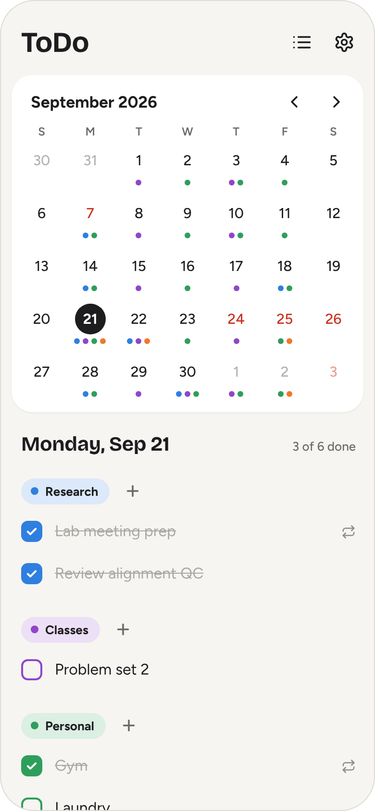
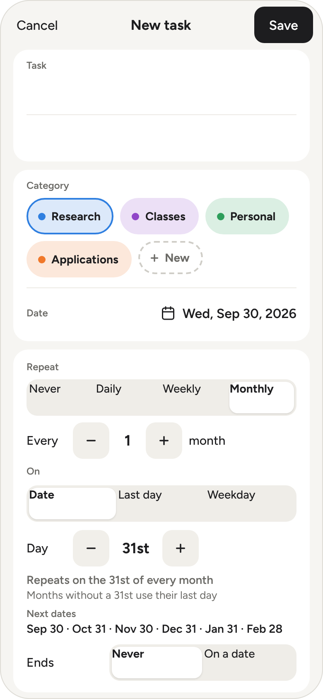
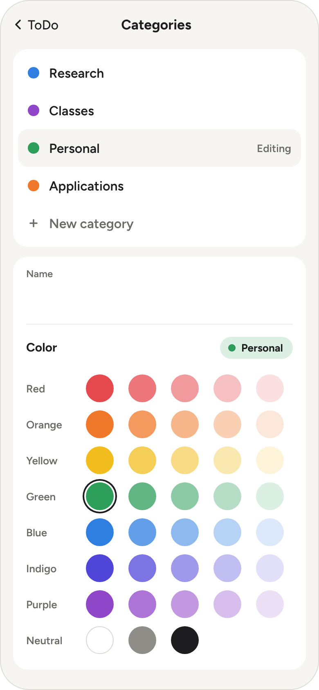
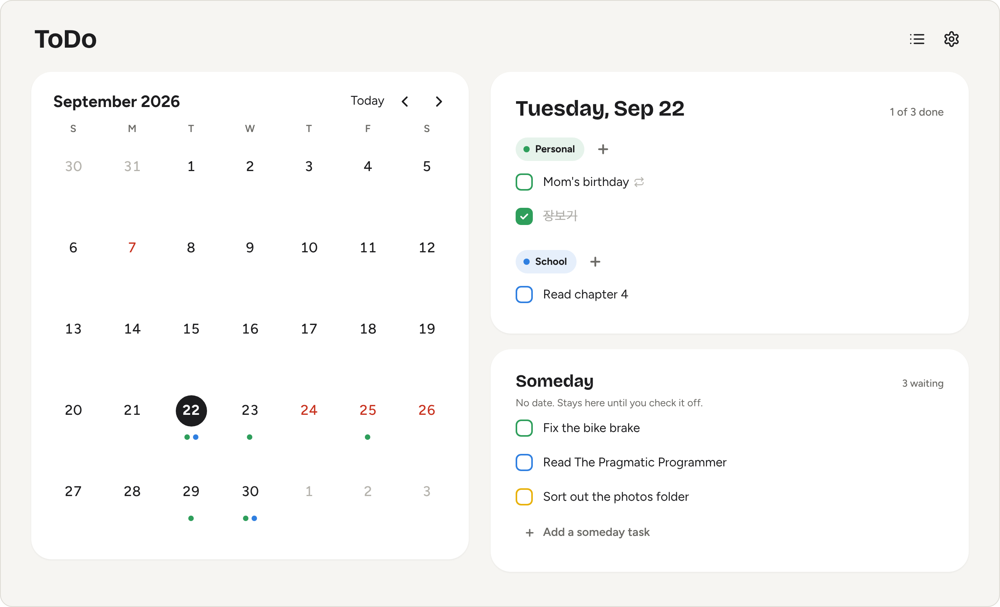
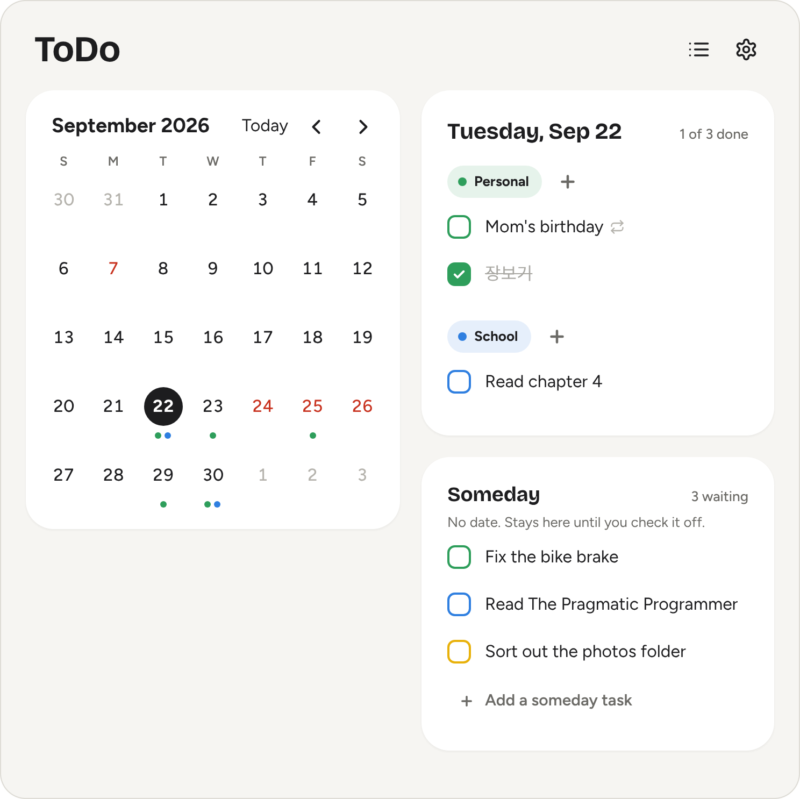

<p align="center">
  
</p>

<h1 align="center">ToDo</h1>

<p align="center">A color-coded calendar to-do app I built for myself, to use on my iPhone, iPad and MacBook.</p>

> [!NOTE]
> This is a personal project made only for my own use. It isn't on the App Store, accounts are created by hand, and I'm not taking feature requests or offering support. You're welcome to look around the code.

## Why I made it

For a long time I used todo mate on all three of my devices. I liked its color coding and its repeat options. Then the Mac app started requiring a paid subscription.

I looked for a replacement, but none of the current to-do apps felt right. The ones close to what I wanted kept basics like calendar views or repeating tasks behind a premium plan, and I didn't want to pay a subscription just for a to-do list. So I built my own, with only the features I actually use.

## Features

- **Month calendar.** Each day shows a colored dot for every category that has tasks that day.
- **Color-coded categories.** 7 hues in 5 shades each, plus white, gray and black.
- **Repeating tasks.** Daily, weekly, monthly (by date, last day or weekday) and yearly, with an optional end date. Yearly repeats can follow the lunar calendar.
- **Someday list.** Tasks with no date stay there until I check them off.
- **Moving tasks.** Move one task forward a day, or move every unfinished task from a past day to today at once.
- **Holidays.** US and Korean public holidays show in red, and each set can be turned off.
- **Drag to reorder.** Works for tasks, Someday items and categories.
- **Finished tasks sink.** Checked tasks drop to the bottom of their list.
- **Works offline.** Changes save on the device first and sync through Supabase when there's a connection.
- **Installs like an app.** Added to the Home Screen on iPhone and iPad, and to the Dock on Mac.

## Design

Mockups from the design stage, filled with sample data.

<table>
  <tr>
    <td align="center"></td>
    <td align="center"></td>
    <td align="center"></td>
  </tr>
  <tr>
    <td align="center"><sub>Calendar and tasks</sub></td>
    <td align="center"><sub>New task with a repeat</sub></td>
    <td align="center"><sub>Categories and colors</sub></td>
  </tr>
</table>

<table>
  <tr>
    <td align="center"></td>
    <td align="center"></td>
  </tr>
  <tr>
    <td align="center"><sub>MacBook</sub></td>
    <td align="center"><sub>iPad</sub></td>
  </tr>
</table>

## How it's built

- Plain HTML, CSS and JavaScript, with no framework and no build step
- [Supabase](https://supabase.com) for sign-in and syncing between devices (`supabase/setup.sql` creates the tables)
- Hosted on [Netlify](https://www.netlify.com)
- A service worker caches the app so it opens without a connection
- [SortableJS](https://github.com/SortableJS/Sortable) for drag and drop, [korean-lunar-calendar](https://www.npmjs.com/package/korean-lunar-calendar) for lunar dates, and [holidays-kr](https://github.com/hyunbinseo/holidays-kr) for Korean holiday data

## Project structure

```
index.html             app shell
styles.css             styles
config.js              Supabase URL and publishable key
sw.js                  offline cache
manifest.webmanifest   install settings
js/
  app.js               screens and interactions
  store.js             offline-first local data
  sync.js              background sync with Supabase
  repeat.js            repeat rules, including lunar dates
  dates.js             date helpers
  holidays.js          US and Korean holidays
  holiday-feed.js      Korean holiday updates
  palette.js           category colors
  vendor/              Supabase, SortableJS, korean-lunar-calendar
supabase/setup.sql     database tables and access rules
fonts/                 Figtree and Bricolage Grotesque
icons/                 app icons
```
